<div align="center">
<picture>
  <source media="(prefers-color-scheme: dark)" srcset="assets/logo-dark.png">
  
</picture>

### Business email on your own domains, running free in your Cloudflare account

Mailboxes, aliases and shared inboxes for every domain you own. One Worker and one database in<br>
your own Cloudflare account, with apps for Windows, macOS and Android.

[](https://github.com/Neutx/MurphyInbox/releases/latest)
[](https://deploy.workers.cloudflare.com/?url=https://github.com/Neutx/MurphyInbox)
[](LICENSE)

[Download](#download) · [Features](#features) · [Screenshots](#screenshots) · [Deploy](#deploy) · [Free-tier limits](#free-tier-limits) · [Roadmap](#roadmap)

</div>

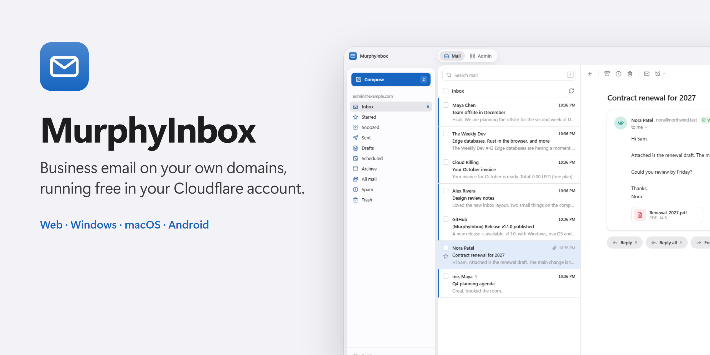

## Download

| Platform | File | Notes |
| --- | --- | --- |
| **Windows** 10 and 11 | [MurphyInbox-Setup-windows-x64.exe](https://github.com/Neutx/MurphyInbox/releases/latest) | Runs in the tray, notifications, opens at login |
| **macOS** 12 and later | [MurphyInbox-macos-universal.dmg](https://github.com/Neutx/MurphyInbox/releases/latest) | Apple silicon and Intel, menu bar icon, Dock badge |
| **Android** 5 and later | [MurphyInbox-android.apk](https://github.com/Neutx/MurphyInbox/releases/latest) | Full screen, push notifications, offline reading. Needs Chrome |
| **iPhone and iPad** | No download | In Safari, tap **Share → Add to Home Screen** (iOS 16.4+ for notifications) |
| **Any browser** | [mail.murphylabs.org](https://mail.murphylabs.org) | Installable from Chrome, Edge and Safari |

Every app opens the web app, so updates arrive without reinstalling. Checksums are in `SHA256SUMS.txt` on each [release](https://github.com/Neutx/MurphyInbox/releases).

<details>
<summary>First launch warnings</summary>

The apps are not yet signed with paid certificates, so each system asks once:

- **Windows:** SmartScreen says "Windows protected your PC". Choose **More info → Run anyway**.
- **macOS:** right-click MurphyInbox in Applications and choose **Open**, or go to **System Settings → Privacy & Security → Open Anyway**.
- **Android:** allow installing apps from your browser or file manager when asked.

</details>

## Features

**Mail**

- Receive on any domain in your Cloudflare account. Email Routing is set up for you.
- Send through Resend, Brevo, Mailjet, Cloudflare Email Sending or any SMTP server. When one provider reaches its free limit, mail moves on to the next.
- Threads, All Mail, search (`from:` `has:attachment` `before:`), labels, filters, snooze, scheduled send and undo send.
- Signatures, auto-reply, drafts, a command palette (Ctrl/⌘ K) and keyboard shortcuts.

**Everywhere you are**

- **Push notifications** for new inbox mail on phones and computers, even when MurphyInbox is closed. Each device is turned on in **Settings → Appearance**.
- **Installable and offline.** Add it to a home screen or desktop; mail you've opened stays readable without a connection.
- **Native apps** for Windows, macOS and Android, built and published automatically from this repository.

**Design**

- An interface that follows Apple's Human Interface Guidelines: system type, Liquid Glass on the navigation layer only, solid surfaces for reading.
- Light and dark mode, and an accent color picker (Murphy Blue, Teal, Green, Orange, Red, Pink, Graphite).
- Honors Reduce Motion, Reduce Transparency and Increase Contrast. Works on phone-sized screens.

**Teams and admin**

- Personal and shared inboxes, aliases, `you+tag@` addressing and catch-all.
- Dashboard with traffic, free-tier usage, delivery logs and an audit log.
- Domain health checks with one-click repair. SPF, DKIM and DMARC records are written for you.
- Attachments of any size with optional R2 storage (10 GB free).

**Security**

- HTML mail is sanitized and sandboxed, and remote images stay blocked until you allow them.
- Mail that fails SPF, DKIM or DMARC goes to Spam.
- Optional two-factor sign-in. Stored credentials are encrypted. Signing out clears a device's offline copy.

## Screenshots

<sub>Click any screenshot to open it full size.</sub>

**Mail**

<table>
  <tr>
    <td width="50%" align="center"><a href="assets/screens/mail-light.png">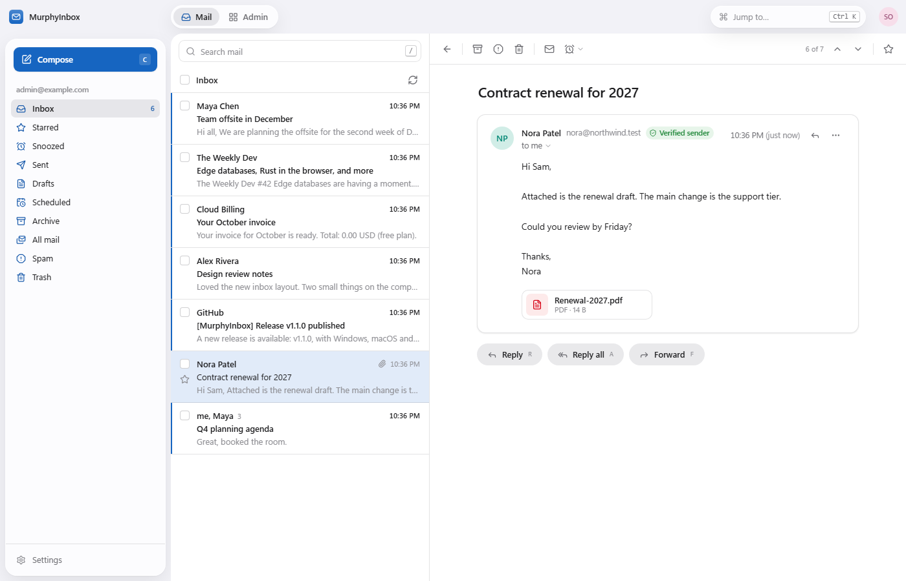</a><br><sub>Inbox</sub></td>
    <td width="50%" align="center"><a href="assets/screens/mail-dark.png">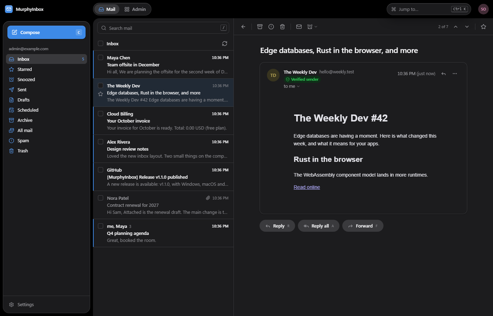</a><br><sub>Dark mode</sub></td>
  </tr>
  <tr>
    <td width="50%" align="center"><a href="assets/screens/mail-composer.png">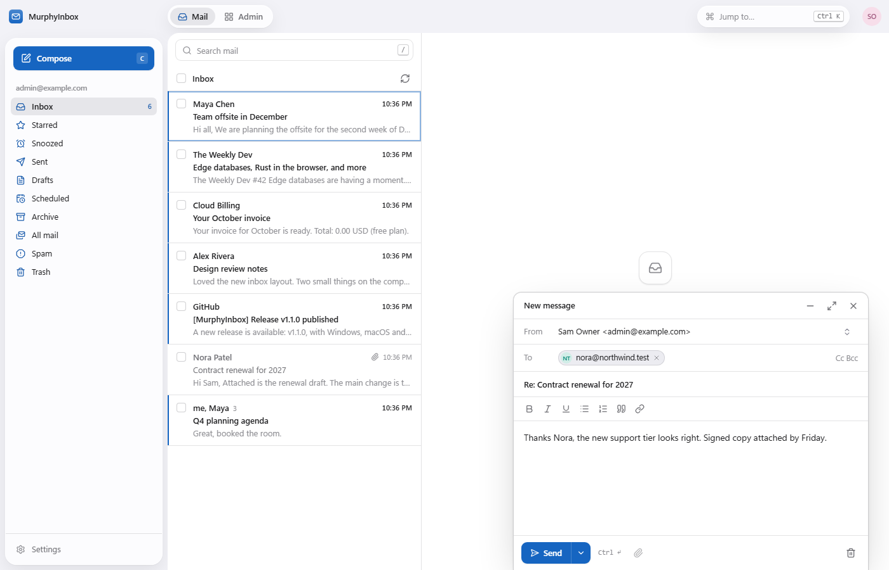</a><br><sub>Composer</sub></td>
    <td width="50%" align="center"><a href="assets/screens/mail-command-palette.png">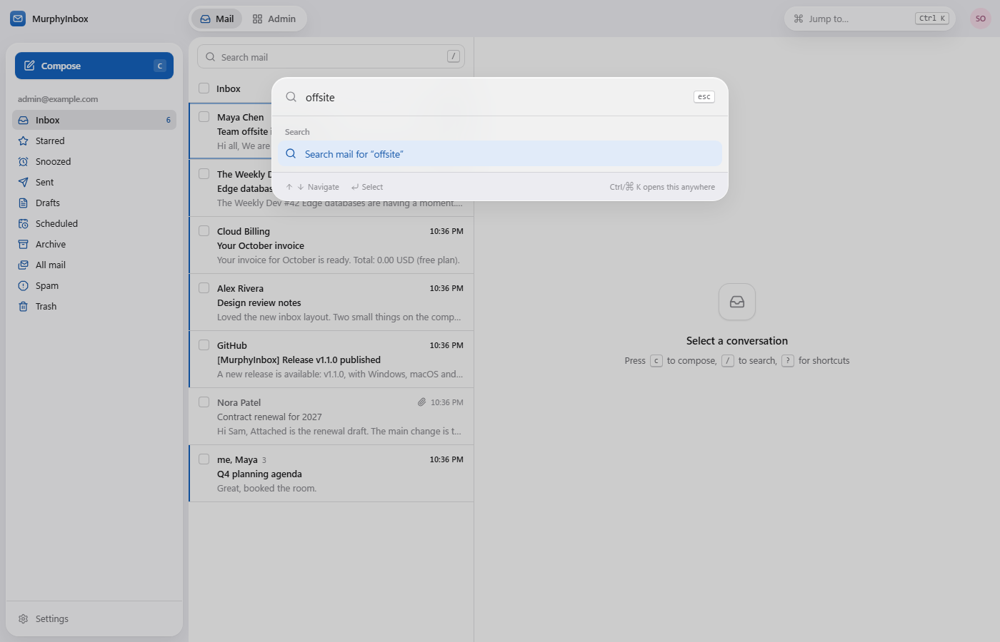</a><br><sub>Command palette</sub></td>
  </tr>
</table>

**Phone**

<table>
  <tr>
    <td width="25%" align="center"><a href="assets/screens/mobile-inbox.png">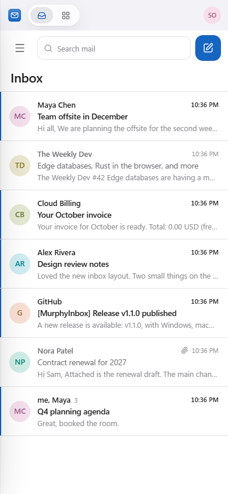</a><br><sub>Inbox</sub></td>
    <td width="25%" align="center"><a href="assets/screens/mobile-thread.png">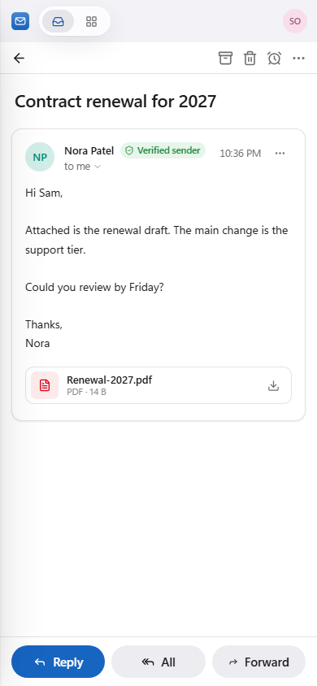</a><br><sub>Conversation</sub></td>
    <td width="50%" align="center"><a href="assets/screens/settings-appearance.png">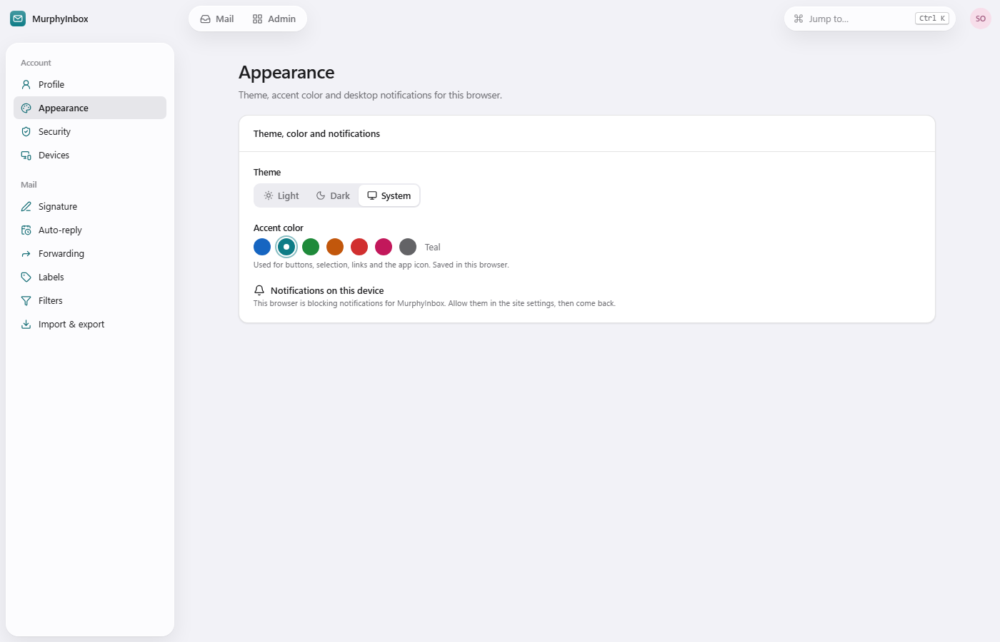</a><br><sub>Theme, accent color and notifications</sub></td>
  </tr>
</table>

**Admin**

<table>
  <tr>
    <td width="33%" align="center"><a href="assets/screens/admin-overview-light.png">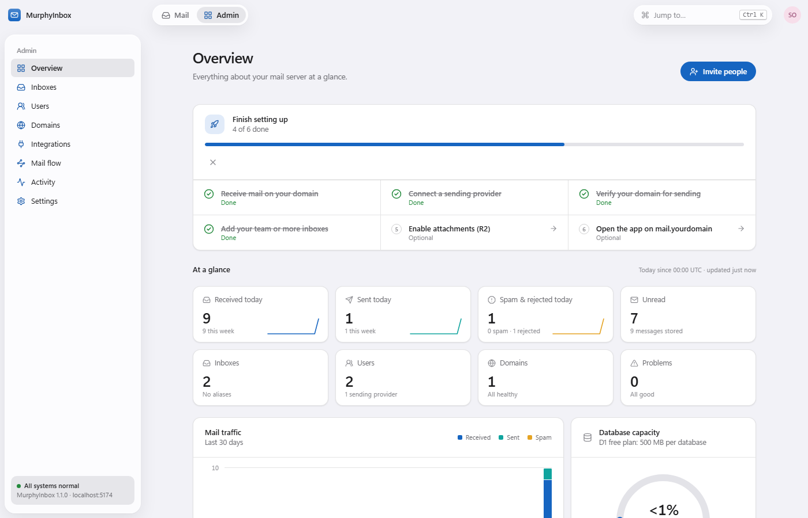</a><br><sub>Overview</sub></td>
    <td width="33%" align="center"><a href="assets/screens/admin-overview-dark.png">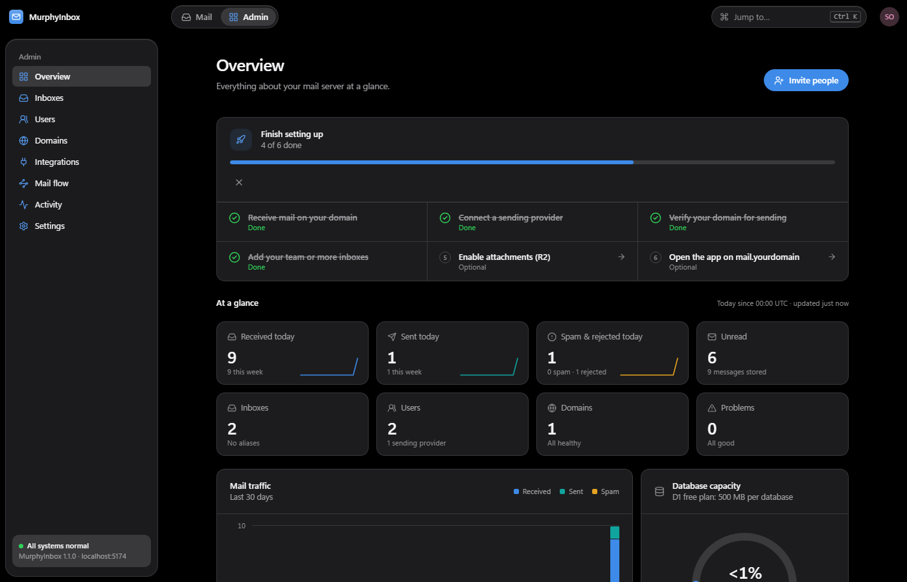</a><br><sub>Overview, dark</sub></td>
    <td width="33%" align="center"><a href="assets/screens/admin-mail-flow-dark.png">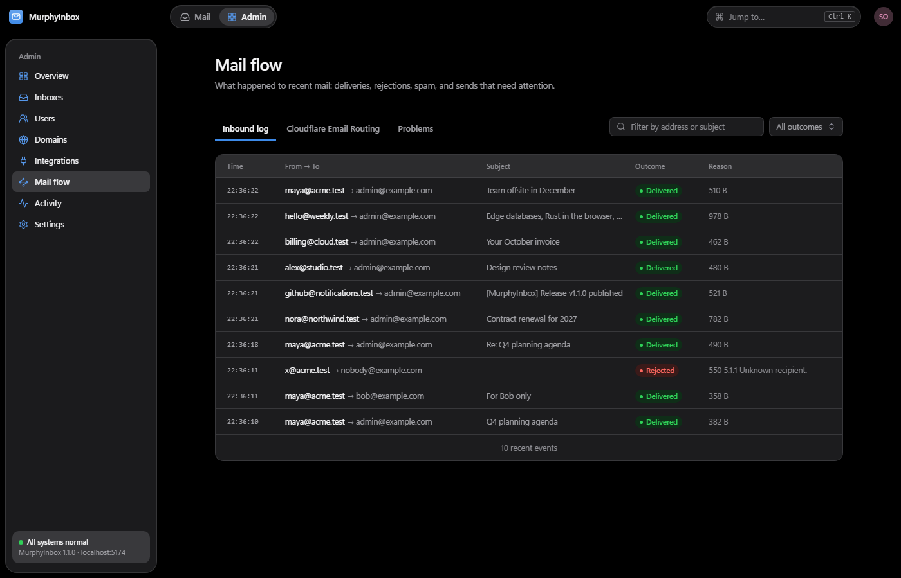</a><br><sub>Mail flow</sub></td>
  </tr>
  <tr>
    <td width="33%" align="center"><a href="assets/screens/admin-users.png">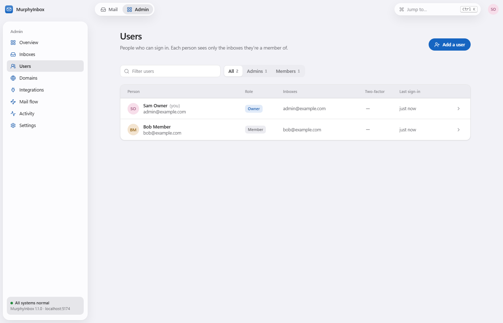</a><br><sub>Users</sub></td>
    <td width="33%" align="center"><a href="assets/screens/admin-domains.png">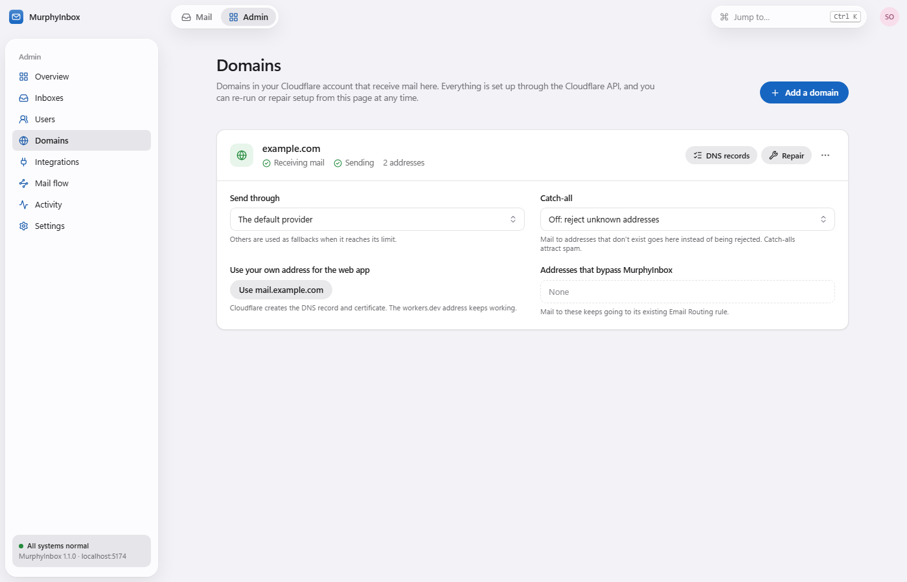</a><br><sub>Domains</sub></td>
    <td width="33%" align="center"><a href="assets/screens/admin-integrations.png">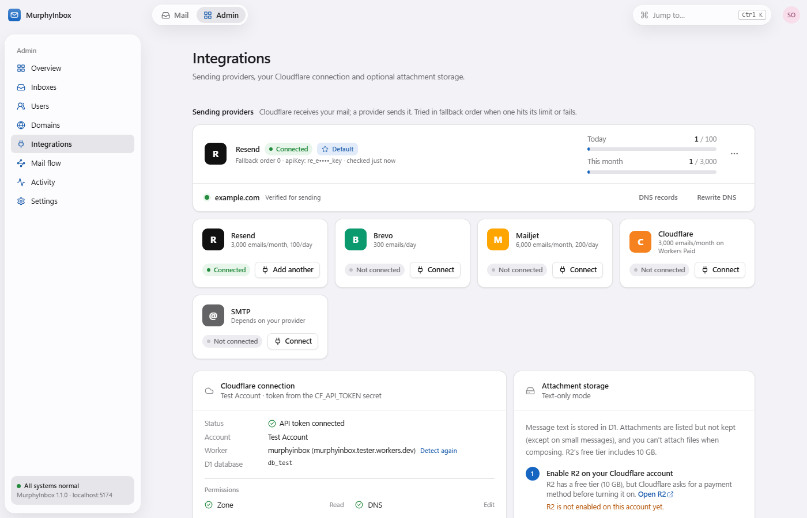</a><br><sub>Integrations</sub></td>
  </tr>
</table>

## How it works

Everything runs inside your own Cloudflare account. There is no MurphyInbox server in between.

| Part | What it does |
| --- | --- |
| **Cloudflare Email Routing** | Receives mail for your domains and hands it to the Worker |
| **One Worker** | Runs the web app, the API, inbound mail, push notifications and scheduled jobs |
| **One D1 database** | Stores mailboxes, messages, users and settings |
| **A sending provider** | Delivers outgoing mail (Resend, Brevo, Mailjet, Cloudflare or SMTP), with fallback between them |
| **R2 (optional)** | Keeps attachments of any size |
| **Apps** ([desktop/](desktop/), [android/](android/)) | Electron for Windows and macOS, a Trusted Web Activity for Android. All three load the web app |

Push notifications use the standard Web Push protocol, encrypted on the Worker with WebCrypto, and are delivered free by Apple, Google and Mozilla's push services.

## Deploy

### Requirements

- A free Cloudflare account, with a domain on Cloudflare's nameservers.
- A GitHub account.
- A free account with a sending provider. This is only needed to send; receiving works without one. Sending through Cloudflare itself needs the Workers Paid plan.

### Steps

**1. Click [Deploy to Cloudflare](https://deploy.workers.cloudflare.com/?url=https://github.com/Neutx/MurphyInbox)**, then **Deploy**. The form asks for nothing else.

**2. Open the Worker's `workers.dev` address.** The setup page asks for a Cloudflare API token, which MurphyInbox uses to set up Email Routing and DNS. Click **Create token**: Cloudflare opens with every permission filled in, so you only click **Continue to summary → Create Token** and paste the token back. It is stored encrypted.

> [!TIP]
> If the Worker shows no `workers.dev` URL, turn it on in the Worker's **Settings → Domains & Routes**.

> [!IMPORTANT]
> Connecting the token creates your **recovery key** and shows it **once**. Save it in a password manager. It is the only way back into the owner account if you lose your password.

**3. Follow the setup page.** It checks the token's permissions, creates your admin account and connects your domain.

**4. Connect a sending provider** in **Admin → Integrations**, and optionally open the app on `mail.yourdomain` from the same page.

<table>
  <tr>
    <td width="50%" align="center"><a href="assets/screens/setup-checks.png">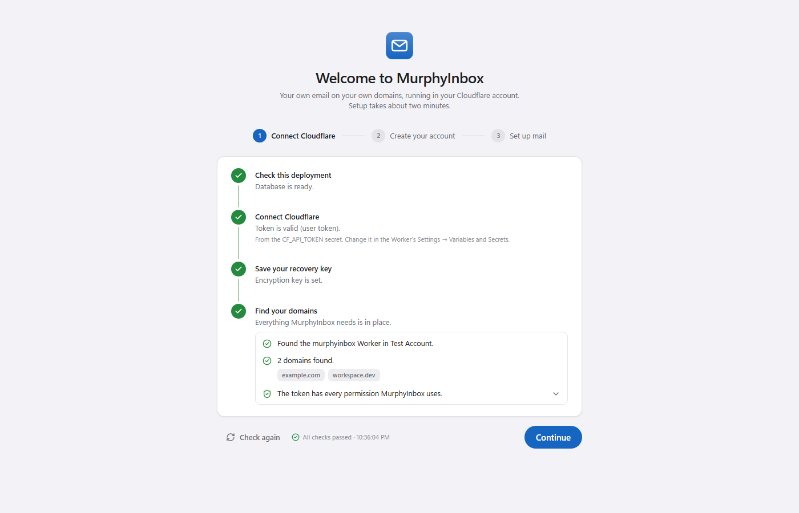</a><br><sub>The setup page checks the token</sub></td>
    <td width="50%" align="center"><a href="assets/screens/setup-admin.png">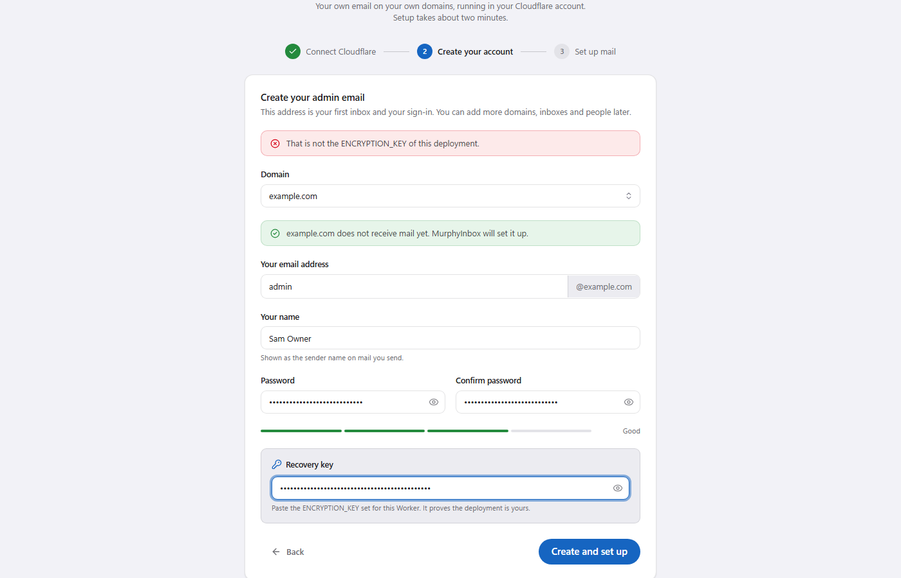</a><br><sub>Create your admin account</sub></td>
  </tr>
</table>

<details>
<summary>The token's permissions (filled in for you by <a href="https://dash.cloudflare.com/?to=/:account/api-tokens&amp;permissionGroupKeys=%5B%7B%22key%22%3A%22c8fed203ed3043cba015a93ad1616f1f%22%2C%22type%22%3A%22read%22%7D%2C%7B%22key%22%3A%224755a26eedb94da69e1066d98aa820be%22%2C%22type%22%3A%22edit%22%7D%2C%7B%22key%22%3A%223030687196b94b638145a3953da2b699%22%2C%22type%22%3A%22edit%22%7D%2C%7B%22key%22%3A%2279b3ec0d10ce4148a8f8bdc0cc5f97f2%22%2C%22type%22%3A%22edit%22%7D%2C%7B%22key%22%3A%2228f4b596e7d643029c524985477ae49a%22%2C%22type%22%3A%22edit%22%7D%2C%7B%22key%22%3A%229c88f9c5bce24ce7af9a958ba9c504db%22%2C%22type%22%3A%22read%22%7D%2C%7B%22key%22%3A%22e086da7e2179491d91ee5f35b3ca210a%22%2C%22type%22%3A%22edit%22%7D%2C%7B%22key%22%3A%22e4589eb09e63436686cd64252a3aebeb%22%2C%22type%22%3A%22edit%22%7D%2C%7B%22key%22%3A%225df633d6b41c42bcaf5b4a62b9d14b64%22%2C%22type%22%3A%22edit%22%7D%2C%7B%22key%22%3A%22b89a480218d04ceb98b4fe57ca29dc1f%22%2C%22type%22%3A%22read%22%7D%2C%7B%22key%22%3A%22c1fde68c7bcc44588cbb6ddbc16d6480%22%2C%22type%22%3A%22read%22%7D%2C%7B%22key%22%3A%22bf7481a1826f439697cb59a20b22293e%22%2C%22type%22%3A%22edit%22%7D%5D&amp;name=MurphyInbox">this link</a>)</summary>

| Scope | Permission | Access | |
| --- | --- | --- | --- |
| Zone | Zone | Read | required |
| Zone | DNS | Edit | required |
| Zone | Zone Settings | Edit | required: turn on Email Routing |
| Zone | Email Routing Rules | Edit | required |
| Account | Workers Scripts | Edit | required |
| Account | Account Settings | Read | recommended |
| Zone | Workers Routes | Edit | optional: app on `mail.yourdomain` |
| Zone | Analytics | Read | optional: delivery log |
| Account | Email Routing Addresses | Edit | optional: forwarding |
| Account | Email Sending | Edit | optional: send through Cloudflare |
| Account | Account Analytics | Read | optional: usage on the dashboard |
| Account | Workers R2 Storage | Edit | optional: attachments bucket |

</details>

## Free-tier limits

| What | Free limit |
| --- | --- |
| Worker requests | 100,000 / day per account |
| D1 storage | 500 MB, roughly 50,000–100,000 messages |
| R2 attachments (optional) | 10 GB, no download fees |
| Incoming message size | 25 MB |
| Sending | Brevo 300/day, Mailjet 200/day, Resend 100/day; Cloudflare 3,000/month on Workers Paid |
| Push notifications | Free (Apple, Google and Mozilla push services) |

Without R2, mail is stored text-only and attachments are kept only on messages under 950 KB. Turn on R2 in **Admin → Integrations → Attachments** to keep every attachment. Cloudflare asks for a payment method before enabling R2, even for the free tier.

## Use it responsibly

> [!CAUTION]
> MurphyInbox is for real conversations with people who expect to hear from you. It is **not** for cold outreach, bulk marketing, purchased lists or spam.

- **Provider bans.** Resend, Brevo, Mailjet and other providers have strict anti-spam policies. High bounce or complaint rates, unsolicited mail, or working around daily limits can get a sending account **suspended**, and can push your domain's normal mail into spam.
- **Cloudflare's terms apply too.** Abusing Email Routing or Workers can get your account restricted.
- **Follow anti-spam laws** such as CAN-SPAM, GDPR and CASL.

## Updating

**Server:** pull the latest code and run `npm run deploy`. The Worker applies database migrations itself. The admin overview shows when a new release is out.

**Apps:** nothing to do for most updates, because the apps load the web app. A new app release is only needed for changes to the apps themselves.

**Releasing apps:** push a version tag and [the release workflow](.github/workflows/release.yml) builds all three apps and publishes a draft release with checksums:

```sh
git tag v1.2.0 && git push origin v1.2.0
```

The Android build is signed with the key in the repository secrets (`ANDROID_KEYSTORE_B64`, `ANDROID_KEYSTORE_PASSWORD`, `ANDROID_KEY_ALIAS`); its fingerprint must match [assetlinks.json](src/web/public/.well-known/assetlinks.json). Optional Windows and Apple signing secrets are listed at the top of the workflow.

## Troubleshooting

| Problem | What to do |
| --- | --- |
| Mail not arriving or not sending | **Admin → Domains → Check health**, then **Admin → Mail flow** |
| Locked out of the owner account | On the sign-in page, choose **Owner locked out?** and enter the owner email and recovery key |
| No notifications on iPhone | Open MurphyInbox from its home screen icon, not from Safari, then turn notifications on in Settings |
| Android app shows a browser bar | Chrome is missing or outdated, or the APK wasn't signed with the release key |

## Roadmap

Planned, **not available yet**:

- [ ] **IMAP and SMTP access**, so Apple Mail, Outlook and Thunderbird can use your mailboxes.
- [ ] **Nightly backups** to your R2 bucket.
- [ ] **Calendar invites** with Accept and Decline.
- [ ] **Inbox API** with per-user keys, and **webhooks** for incoming mail.
- [ ] **AI writing help** using Cloudflare Workers AI's free daily allowance.

## Contributing

Bug reports, fixes and new sending providers (each is one adapter in [src/worker/providers/](src/worker/providers/)) are welcome. Before opening a pull request, run `npm run lint && npm run typecheck && npm test && npm run test:e2e`.

### Development setup

```sh
npm ci
# create .dev.vars with the lines below
npm run db:migrate:local
npm run dev:mock                 # terminal 1: mock Cloudflare and provider APIs on :8790
npm run dev                      # terminal 2: app on http://localhost:5173
```

Local `.dev.vars` (never put real credentials here):

```sh
ENCRYPTION_KEY=any-long-random-string-for-local-use
CF_API_TOKEN=dev-token
CF_API_BASE=http://127.0.0.1:8790/cf
RESEND_API_BASE=http://127.0.0.1:8790/resend
BREVO_API_BASE=http://127.0.0.1:8790/brevo
MAILJET_API_BASE=http://127.0.0.1:8790/mailjet
GITHUB_API_BASE=http://127.0.0.1:8790/github
WORKER_NAME=murphyinbox
```

Desktop app: `cd desktop && npm ci && npm start`. Screenshots in this README: `OI_SCREENSHOTS=1 npm run test:e2e`. Icons and brand images: `node scripts/make-app-icons.mjs`.

### Security

Report security issues privately through **Security → Report a vulnerability**, not in a public issue.

## License

[MIT](LICENSE)
